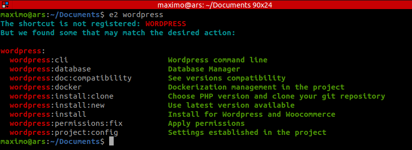

# EFDE | Easy and Fast Development Environment 
# Wordpress

## Shortcuts

Available shortcuts (defined in `console/implementation/wordpress/props/shortcuts`):

- `wordpress:project:config` — Show settings in the project.
- `wordpress:cli` — WP-CLI (WordPress command line).
- `wordpress:permissions:fix` — Fix permissions.
- `wordpress:install` — Select project type (New or Existing).
- `wordpress:install:new` — Create new project.
- `wordpress:install:clone` — Clone existing project.
- `wordpress:doc:compatibility` — See versions compatibility.

## Install

See the main EFDE docs for installation and project configuration:

[Project config and basic use](../../../../docs/implementation.md#project-config)
[Skills reference](../../../../agents/efde/impl-wordpress/SKILL.md)
