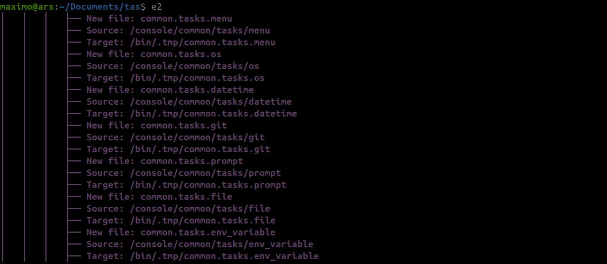
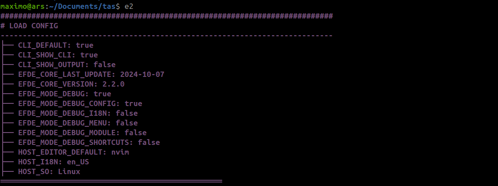
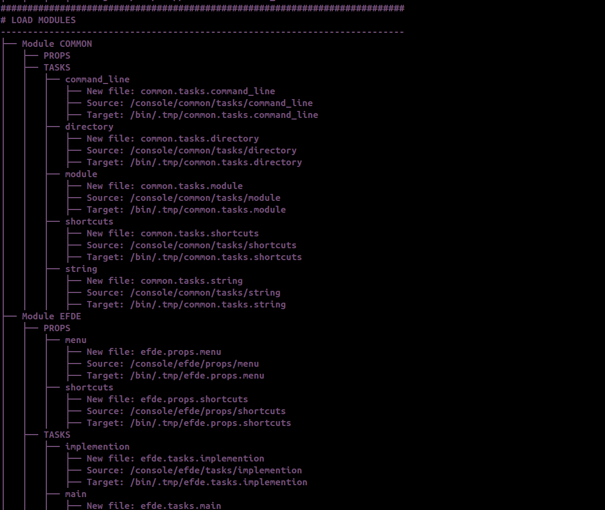
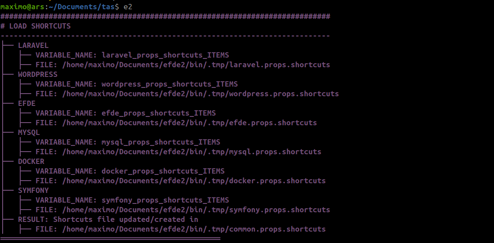
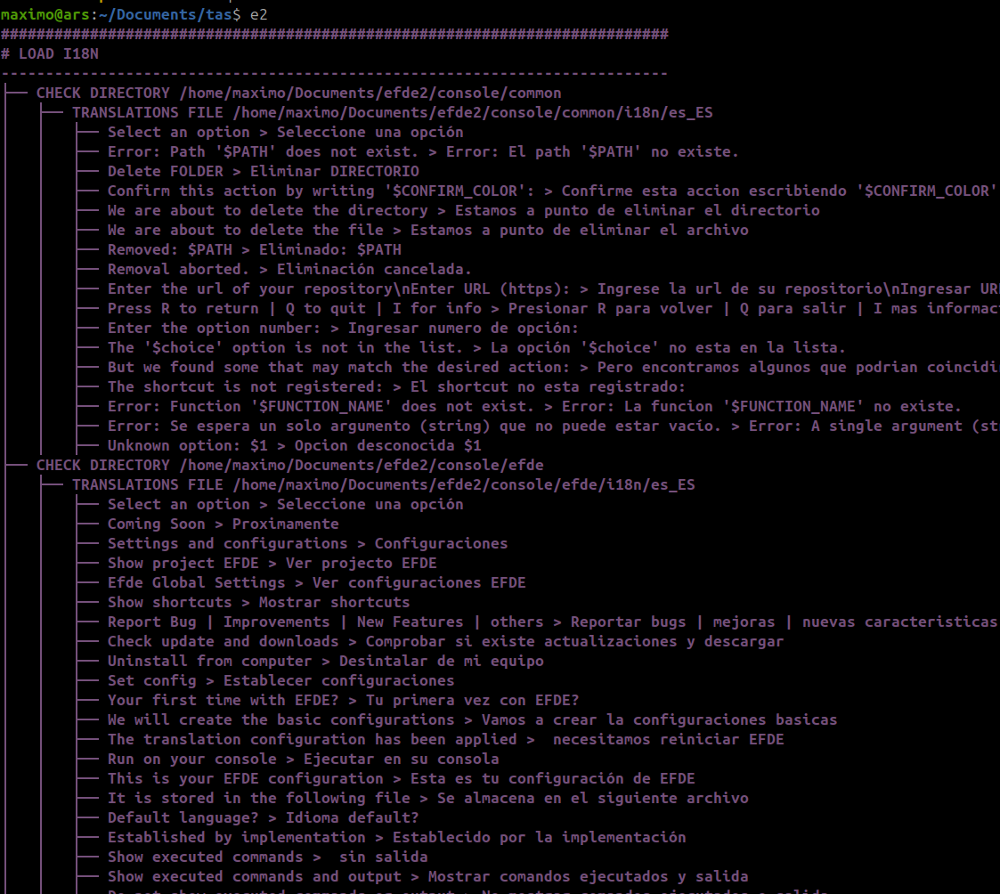
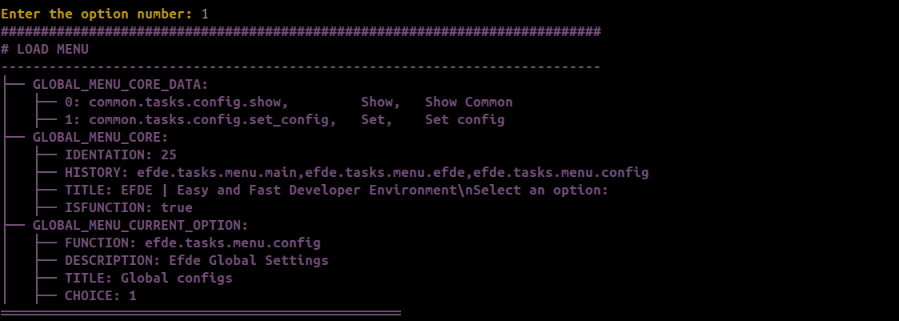
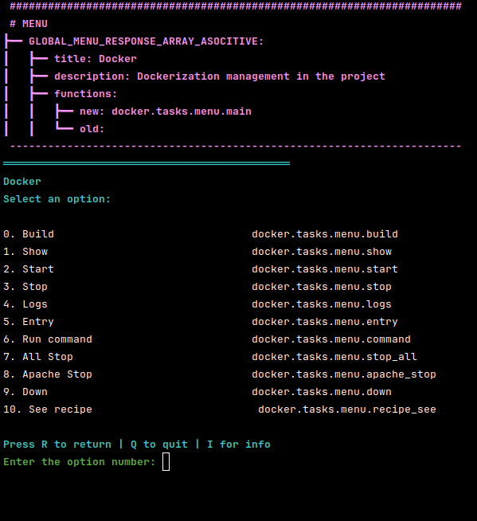
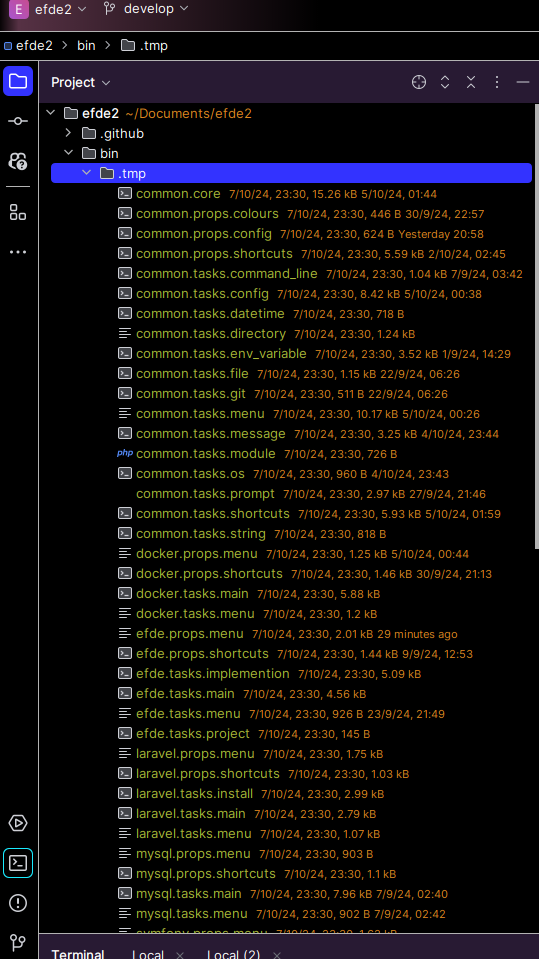

# Modo Debug en EFDE

Documentación de uso del modo debug para desarrolladores y colaboradores.

## Para qué sirve

- **Ver el flujo de arranque**: qué módulos se cargan, cómo se generan shortcuts e i18n.
- **Forzar regeneración**: con `DEBUG=true`, en cada ejecución se borra `bin/.tmp` y se reconstruyen los archivos transformados, shortcuts e i18n (útil al cambiar código en `console/`).
- **Depurar por capas**: activar solo MODULES, SHORTCUTS, I18N, CONFIG o MENU para reducir ruido.

---

## Cómo configurarlo

Tras la primera ejecución se genera el archivo de configuración. Edita **`bin/cfg.core`** (en la raíz de tu instalación EFDE):

```sh
DEBUG="true"              # Maestro: debe estar en "true" para que el resto tenga efecto
DEBUG_MODULE="false"      # Carga de módulos y archivos (console → bin/.tmp)
DEBUG_SHORTCUTS="false"   # Generación del archivo común de shortcuts
DEBUG_I18N="false"        # Aplicación de traducciones
DEBUG_CONFIG="false"      # Variables cargadas (EFDE_CONFIG_CORE, EFDE_CONFIG_HOST)
DEBUG_MENU="false"        # Datos del menú (GLOBAL_MENU_*, opción actual)
```

- **DEBUG**: si está en `"false"`, ningún otro flag muestra salida.
- Los demás se activan con `"true"` según lo que quieras inspeccionar.

---

## Qué hace cada opción

| Opción | Qué muestra / qué hace |
|--------|-------------------------|
| **DEBUG** | Maestro. En `true` además se borra `bin/.tmp` al arrancar y se regenera todo (módulos, shortcuts, i18n). |
| **DEBUG_MODULE** | Carga de cada módulo (common, efde, laravel, docker, etc.) y de cada archivo (tasks/main, props/menu, …). |
| **DEBUG_SHORTCUTS** | Regeneración del archivo de shortcuts; lista de implementaciones y archivo generado. Sin debug, se reutiliza el archivo existente en `.tmp` si existe. |
| **DEBUG_I18N** | Directorios y archivos i18n revisados; sustituciones aplicadas (origen → destino). Útil para comprobar que las cadenas coinciden con el código. |
| **DEBUG_CONFIG** | Tras cargar la config, lista las variables de `EFDE_CONFIG_CORE` y `EFDE_CONFIG_HOST`. |
| **DEBUG_MENU** | Al mostrar el menú: datos de `GLOBAL_MENU_CORE_DATA`, `GLOBAL_MENU_CORE`, `GLOBAL_MENU_CURRENT_OPTION`; descripciones de opciones en color debug. |

---

## Imágenes de referencia

<details>
<summary>Debug Essential (arranque)</summary>


</details>

<details>
<summary>Debug CONFIG</summary>


</details>

<details>
<summary>Debug MODULES</summary>


</details>

<details>
<summary>Debug SHORTCUTS</summary>


</details>

<details>
<summary>Debug I18N</summary>


</details>

<details>
<summary>Debug MENU</summary>


</details>

### Efecto de DEBUG=true en el arranque

| Comportamiento | Descripción |
|----------------|-------------|
| Información extra en pantalla | Se muestra el flujo de carga y las acciones de debug activas. |
| Regeneración de `bin/.tmp` | En cada ejecución se borra el directorio y se vuelven a transformar los archivos de `console/` (sed de `_mod_.` a `modulo.tasks.xxx`), se regeneran shortcuts y se aplican traducciones. |

  


---

## Nota sobre el arranque (early boot)

Existe un debug “muy temprano” (`ESSENTIAL_MODULES['DEBUG']` en `common/core`) que se evalúa **antes** de cargar la config. Solo muestra mensajes tipo “LOAD COMMON (ESSENTIAL TO RUN)” y el árbol de módulos/elementos en esa fase. No se controla desde `bin/cfg.core`; para verlo habría que cambiar el valor en el código de core. El uso normal del debug es el de `bin/cfg.core` (DEBUG + DEBUG_MODULE, etc.).
